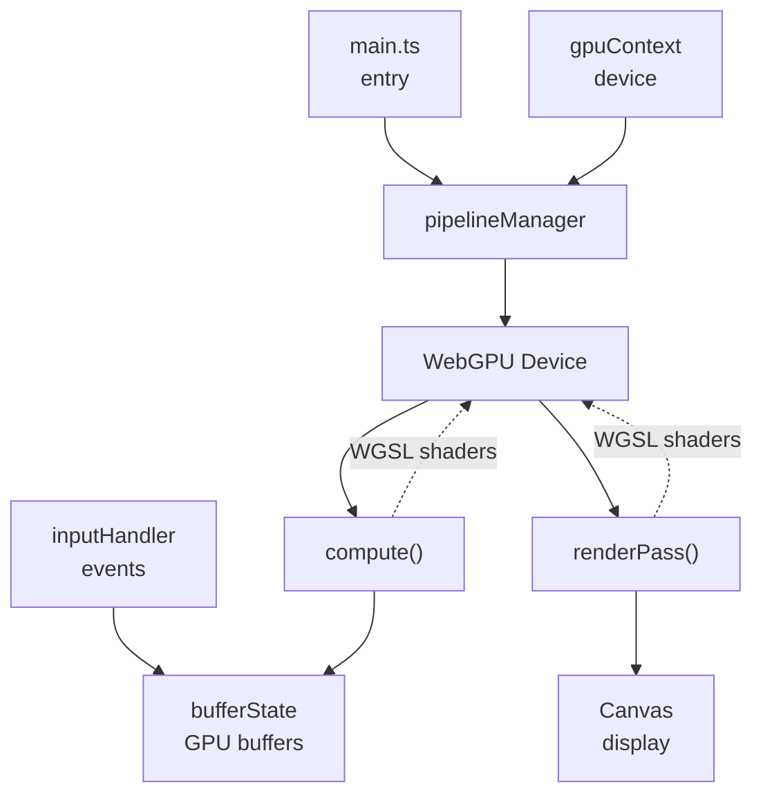

# WebGPU · WGSL Dynamic Quality & Touch

Dynamiczne skalowanie rozdzielczości w stylu YouTube, obsługa pełnego ekranu i precyzyjny dotyk na canvasie w WebGPU.

## 📖 Overview

High-performance particle simulation demo built with **WebGPU** and **WGSL (WebGPU Shading Language)**. Features compute shaders for physics, dynamic quality scaling, touch/mouse interaction, fullscreen support, and live performance HUD.

## ✨ Features

- WebGPU Compute Shaders – GPU-based particle physics
- Dynamic Quality Scaling – 1080p / 720p / 480p / 360p / 240p presets (YouTube-style)
- Touch & Mouse Input – Interactive canvas physics
- Fullscreen Support – Cross-browser including iOS/Safari
- Live Performance HUD – Real-time FPS, time, resolution, particle count
- Hot Module Replacement – Live shader reloading during dev

## 🛠 Technology Stack

| Category        | Tool                           |
| --------------- | ------------------------------ |
| Build System    | Vite v1.0+                     |
| Language        | TypeScript 5.x                 |
| GPU API         | WebGPU (`@webgpu/types`)       |
| Shaders         | WGSL (WebGPU Shading Language) |
| Package Manager | pnpm v12                       |

## 🚀 Quick Start

### Prerequisites

Node.js 18+ and npm / pnpm. VS Code recommended for HMR shader reloading.

### Installation

```bash
git clone https://github.com/ziemniak/webgpu-ziemniak.git
cd webgpu-ziemniak
pnpm install
```

### Running the Project

````bash
# Development mode with hot reload
pnpm dev

# SSL development (HTTPS on localhost)
pnpm lanssl

# Build for production
pnpm build

# Preview production build
```pnpm
pnpm preview
````

The project launches at `http://localhost:5173` by default. Open it in any modern WebGPU-supported browser.

## 📁 Project Structure

```text
webgpu-ziemniak/
├── src/
│   ├── _compute.wgsl      # Compute shader (particle physics)
│   ├── _render.wgsl       # Fragment shader (rendering)
│   ├── assets/default.css # App styling
│   ├── buffers.ts         # GPU buffer management
│   ├── gpuContext.ts      # WebGPU device initialization
│   ├── inputHandler.ts    # Mouse/touch event handling
│   ├── main.ts            # Application entry point
│   └── pipelineManager.ts # Shader pipeline creation
├── package.json           # Project metadata & scripts
├── pnpm-lock.yaml         # Dependency lock file
├── README.md              # This file
└── .gitignore             # Git ignore rules
```

## 🎮 How It Works

### 1. GPU Context Initialization

Creates a WebGPU device with `auto` quality (matching display DPI) and canvas context.

### 2. Shader Compilation & Pipeline Creation

WGSL shaders compile to compute and render pipelines:

- **Compute Pipeline** – Particle physics on GPU
- **Render Pipeline** – Draws particles to screen

### 3. Buffer Management

Particle data (positions, velocities, colors) stored in GPU buffers, updated each frame via params buffer.

### 4. Render Loop

```sequence
requestAnimationFrame → Update Params → Execute Compute Pass → Execute Render Pass → Next Frame
```

### 5. Dynamic Quality Scaling

User selects quality presets (1080p/720p/480p/360p/240p). Application:

- Adjusts canvas dimensions to match preset
- Resizes all GPU buffers and pipelines
- Updates HUD display

### 6. Input Handling

Mouse position passed as param buffer to compute shader, enabling interactive effects (e.g., repelling particles near cursor).

## 🔧 Development & Hot Reload

During development with `pnpm dev`, edit `.wgsl` files directly in your editor. Vite hot module replacement automatically reloads and recompiles shaders without restarting the server.

**Supported hot reload:**

- `_compute.wgsl` – Compute physics shader
- `_render.wgsl` – Render/fragment shader

## 📐 Architecture Overview



## 🎨 Shader Pipeline Details

Planned later: a gallery of shader variants from the test set can be added for comparison and exploration.

### Compute Shader (`_compute.wgsl`)

Runs on GPU for particle physics simulation. Handles position updates, velocity calculations, collision detection, and screen-space interactions. Outputs updated positions back to buffer state.

### Render Shader (`_render.wgsl`)

Fragment shader responsible for drawing particles. Uses texture sampling and custom shading to produce final pixel output on the canvas.

## 📝 Contribution Guidelines

1. **Fork & Pull Request** – All changes via pull requests
2. **Code Style** – Follow Prettier formatting rules (`pnpm prettier --write .`)
3. **Type Safety** – Maintain TypeScript type definitions in `vite-env.d.ts` and `wgsl.d.ts`
4. **Shader Performance** – Benchmark shader execution times; optimize WGSL code where possible
5. **Documentation** – Update README.md for any significant changes

---

_Built with ❤️ for WebGPU education and experimentation._
